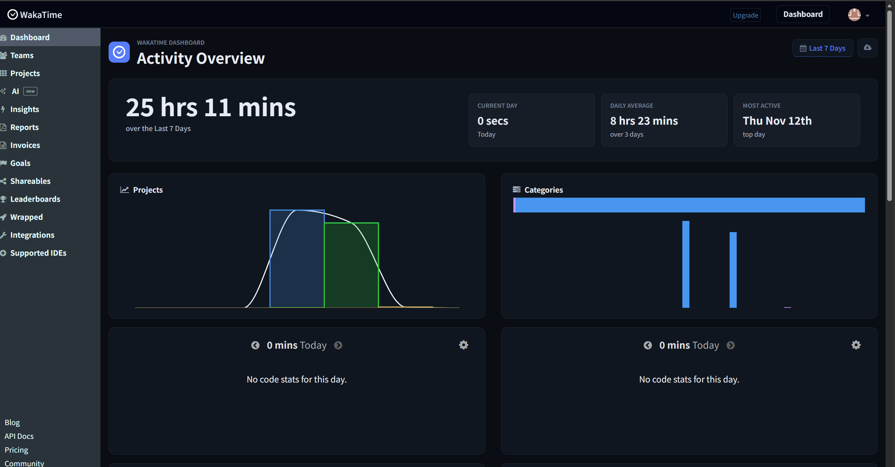

# PROG2004 Assessment 1 — Health Service Appointment System

**Student:** Wu Yanxin · **Student ID:** 25259450
**Project:** A1-Yanxin Wu · **Unit:** PROG2004 Object Oriented Programming

This project is the "backbone" of a small health-service booking system: a set of
collaborating classes plus a scripted `main` method that proves the backbone works. A
separate, optional front desk that a person can type into is added on top of the same
classes and is described in section 8.

---

## 1. Project structure

```
A1-Yanxin Wu/
├── src/                          12 Java files, default package (no package statement)
│   ├── Weekday.java               enum: the fixed set of working days
│   ├── HealthProfessional.java    Part 1 - abstract base class (supertype)
│   ├── GeneralPractitioner.java   Part 2 - required sub-type (adds clinic)
│   ├── Nurse.java                 Part 2 - sub-type (adds ward)
│   ├── Surgeon.java               Part 2 - sub-type (adds surgical specialty)
│   ├── Dietitian.java             Part 2 - sub-type (adds nutrition focus area)
│   ├── Patient.java               Part 4 - the person who books
│   ├── ClinicSchedule.java        Part 4/5 - the fixed daily timetable
│   ├── Appointment.java           Part 4 - patient + professional + time + symptom
│   ├── AppointmentManager.java    Part 5 - the collection and its operations
│   ├── AssignmentOne.java         Part 3 + Part 6 - the graded demonstration (main)
│   └── AppointmentConsole.java    extra - interactive desk you can type into
├── .vscode/                       launch configuration and the three build/run tasks
├── .idea/ + A1-Yanxin Wu.iml      IntelliJ IDEA project (src marked as sources, output in out/)
├── wakatime/A1-Yanxin-Wu-WakaTime.png   WakaTime dashboard screenshot for the submission
├── appointments.txt               created at run time by the desk, git-ignored
├── sample-output.txt              output of the scripted demonstration (for the report)
├── .gitignore
└── README.md
```

`bin/` and `out/` are compiler output and are git-ignored; nothing hand-written lives there.

---

## 2. How to run

No helper script is needed - everything runs from VS Code itself. The three tasks in
`.vscode/tasks.json` are **Build all sources**, **Run front desk (typing)** and
**Run assignment demo (automatic)**; the launch configuration is
**Front desk (keyboard input)**.

* **Press `F5`** - starts `AppointmentConsole` through the **Front desk (keyboard input)**
  configuration, in the integrated terminal. The cursor stops at `Your choice:` and waits
  for you.
* **Ctrl+Shift+P -> `Tasks: Run Task` -> `Run front desk (typing)`** - compiles every
  source file into `bin` (through its `dependsOn`), then runs the same program. Pick
  `Run assignment demo (automatic)` instead when you want the scripted Part 6 demonstration.
* **Ctrl+Shift+B** - runs the default build task `Build all sources`, no run.

### IntelliJ IDEA

The folder is a ready-made IDEA project: `A1-Yanxin Wu.iml` marks `src` as the sources root and
compiled classes go to `out/`, so nothing has to be configured by hand.

1. `File -> Open` and choose the **`A1-Yanxin Wu`** folder (open the folder itself, not `src`).
2. The first time, IDEA may ask for an SDK: pick any JDK **17 or newer** (this machine has
   JDK 27, so `27` is fine).
3. Open `src/AppointmentConsole.java`, click the green arrow next to
   `public static void main`, and choose **Run 'AppointmentConsole.main()'**. Type your
   answers in the Run window at `Your choice:`. Two run configurations are already
   supplied in the run dropdown: **AppointmentConsole (type your answers)** and
   **AssignmentOne (scripted demo)**.
4. For the scripted report, run `AssignmentOne` the same way.

If IDEA shows `Cannot resolve symbol` on any class, the sources root was not picked up:
right-click the `src` folder -> **Mark Directory as -> Sources Root**. If it shows
`switch expressions are not supported at language level 11`, set
`File -> Project Structure -> Project -> Language level` to **17**.

Everything here also compiles from a plain terminal, so both IDEs and the command line
stay in sync:

Command line, if you prefer the terminal:

```
javac --release 17 -encoding UTF-8 -Xlint:all -d bin "src\*.java"
java -cp bin AppointmentConsole
```

`AssignmentOne` is the scripted demonstration that Part 6 of the brief asks for. It has no
prompts by design and is the version to submit and to show in the video; run it only when
you want that printed report:

```
java -cp bin AssignmentOne
```

### Why `--release 17`?

This machine's JDK is 27, but the Java extension inside VS Code runs its own Java 25
runtime. Classes compiled for 27 are labelled class-file version **71.0**, while Java 25
only accepts up to **69.0**, so starting the program from VS Code fails with:

```
java.lang.UnsupportedClassVersionError: AssignmentOne has been compiled by a
more recent version of the Java Runtime (class file version 71.0), this version
of the Java Runtime only recognizes class file versions up to 69.0
```

Compiling with `--release 17` produces version 61.0, which both the JDK 27 command line
and the VS Code runtime accept. If the message ever returns, delete the `bin` folder and
run the task `Run front desk (typing)` (or `Build all sources`), which always compiles
with `--release 17`.

---

## 3. Class relationships at a glance

```
                      Weekday (enum)
                            ▲
                            │ working days
HealthProfessional (abstract)
   │  getRole() / getSpecialistDetails() / toString() / equals()
   ├── GeneralPractitioner   (+ clinicName)
   ├── Nurse                 (+ ward)
   ├── Surgeon               (+ specialty)
   └── Dietitian             (+ focusArea)

Patient ─────────────┐
HealthProfessional ──┴──► Appointment (implements Comparable)
                              ▲
                              │ stored in one ArrayList
                        AppointmentManager ◄──► ClinicSchedule
                              ▲
                              │ typed input
                        AppointmentConsole (extra, not graded)
```

---

## 4. Design decisions, part by part

### Part 1 — Modelling a health professional

| Design question in the brief                                                        | Decision and why                                                                                                                                                                                                                                                                                                                                                                         |
| ----------------------------------------------------------------------------------- | ---------------------------------------------------------------------------------------------------------------------------------------------------------------------------------------------------------------------------------------------------------------------------------------------------------------------------------------------------------------------------------------- |
| What is genuinely common to all professionals?                                      | The numeric ID, the name and the working days. Those three fields live in `HealthProfessional`; anything else (clinic, ward, specialty, focus area) is pushed down to the sub-type, because it is not true of every professional.                                                                                                                                                        |
| The working days are "a fixed collection of values" — how to store them?            | In an `enum`, `Weekday`. Free-text days would let a caller write "Fridy" or "MONDAY" and the timetable would silently disagree with the roster; an enum makes the set of legal values part of the type, and it keeps the printing consistent.                                                                                                                                            |
| External code must read the data but must never put an object into an invalid state | Every field is `private final`; access is read-only through getters. `getWorkingDays()` returns a **copy**, so a caller cannot mutate the roster. The only way to build an object is a constructor that validates its arguments (positive ID, non-blank name, at least one day, no `null` days, duplicates removed). There are therefore no setters that could later break an invariant. |
| Printing an object should show all details in a readable form                       | `toString()` is implemented once in the base class: it prints the role, the shared data and then calls `getSpecialistDetails()`, so one `println(professional)` gives a complete, aligned line.                                                                                                                                                                                          |
| Is a second constructor worthwhile?                                                 | Yes. `HealthProfessional(id, name)` defaults to Monday–Friday, because a full-time professional is the common case. It is implemented with `this(...)` (constructor chaining), so the validation still runs in exactly one place.                                                                                                                                                        |

### Part 2 — Specialising health professionals

| Design question                                                                    | Decision and why                                                                                                                                                                                                                                                                     |
| ---------------------------------------------------------------------------------- | ------------------------------------------------------------------------------------------------------------------------------------------------------------------------------------------------------------------------------------------------------------------------------------ |
| What relationship lets the sub-types reuse the common code?                        | Inheritance: `GeneralPractitioner`, `Nurse`, `Surgeon` and `Dietitian` all `extend HealthProfessional`. The ID/name/roster fields and the printing logic exist once. Adding a fifth type later means adding one class and changing nothing else in the system.                       |
| How is the shared information plus the type-specific information set up correctly? | Every sub-type constructor calls `super(id, name, workingDays)` as its first statement, then validates and stores its own extra field. The parent's validation cannot be skipped or duplicated.                                                                                      |
| How does a sub-type present its combined details?                                  | It overrides `getRole()` (so the object names its own type) and `getSpecialistDetails()` (its own extra data); the base `toString()` assembles both. No sub-type has to repeat the shared part of the output.                                                                        |
| How do different types behave when treated through the same general type?          | Polymorphism: `AssignmentOne` stores them all in one `ArrayList<HealthProfessional>` and prints them with one loop. The loop never asks "which type are you?" — each object describes itself. That is also why the code would barely change if another professional type were added. |
| Should a plain/generic professional be creatable?                                  | No. `HealthProfessional` is `abstract`, so `new HealthProfessional(...)` does not compile, and each sub-type must supply `getRole()` and `getSpecialistDetails()`. This forces every professional in the system to state what kind of professional it is.                            |

### Part 3 — Working with health professional objects

Three general practitioners plus one or two of every other type are created in
`createProfessionals()` (7 objects in total). They are held in a single
`ArrayList<HealthProfessional>` and printed by `printProfessionals()`:

* no repetition — one loop prints all seven, whatever their type;
* they are stored and processed **together**, not in separate variables per type;
* adding another type later requires one line in the factory method and nothing else.

### Part 4 — Modelling an appointment

| Design question                                              | Decision and why                                                                                                                                                                                                                                                                                                                                                                                                       |
| ------------------------------------------------------------ | ---------------------------------------------------------------------------------------------------------------------------------------------------------------------------------------------------------------------------------------------------------------------------------------------------------------------------------------------------------------------------------------------------------------------- |
| Should a patient be its own class?                           | Yes — `Patient`. A name and a mobile number always travel together and an appointment is only valid when both are present, so the validation rule is written once. It also gives Part 5 a precise way to decide "same patient" (`Patient.equals` compares mobile numbers).                                                                                                                                             |
| What information does an appointment hold?                   | The `Patient` object, the `HealthProfessional` object, the time slot and, optionally, the reason for the visit (`symptom`). The professional is stored as the **base type**, so any sub-type can be booked with no extra code.                                                                                                                                                                                         |
| How is an incomplete or invalid appointment made impossible? | The constructor rejects a `null` patient, a `null` professional and any time that is not a real 24-hour `HH:mm` value. There is no setter, so once created the appointment cannot be damaged. This rule is demonstrated in `demonstrateValidation()`.                                                                                                                                                                  |
| Why is the symptom optional rather than required?            | A patient who cannot name their problem should still be able to book. A blank symptom is normalised to `"Not recorded"` by `normalizeSymptom()`, so the field is never `null` and never breaks printing, while a missing symptom does not block a booking. The three-argument constructor delegates to the four-argument one, so the graded demonstration works exactly as before and the extra detail stays optional. |
| How is the professional's own detail shown?                  | `Appointment.getDetails()` delegates to `healthProfessional.toString()`, so the appointment class needs no knowledge of the professional types.                                                                                                                                                                                                                                                                        |
| How can a collection be sorted earliest to latest?           | `Appointment implements Comparable<Appointment>` and compares time slots as text. Because `"HH:mm"` is fixed-width and zero-padded, alphabetical order is chronological order — no parsing, and the comparison is correct for any timetable the clinic chooses. Ties at the same time are broken by professional ID so output is reproducible.                                                                         |
| How should the time be stored?                               | As a `"HH:mm"` string, not as an `int` or a `Date`: it prints exactly as the clinic speaks, it sorts correctly, and it avoids any time-zone or calendar machinery the unit has not covered.                                                                                                                                                                                                                            |

### Part 5 — Managing the collection of appointments

`AppointmentManager` owns a single private `ArrayList<Appointment>` and exposes only
operations:

| Requirement                                                  | Implementation                                                                                                                                                                                                                                                                                                                                                                                                                                                                                                                                                                                           |
| ------------------------------------------------------------ | -------------------------------------------------------------------------------------------------------------------------------------------------------------------------------------------------------------------------------------------------------------------------------------------------------------------------------------------------------------------------------------------------------------------------------------------------------------------------------------------------------------------------------------------------------------------------------------------------------- |
| Add an appointment, ensuring required information is present | `addAppointment(patient, professional, timeSlot, symptom)` checks in the order a receptionist would: patient → professional → is the time a real clinic slot → is the professional free at that time → create the object. Each failure returns a `WARNING:` message; success returns a `SUCCESS:` message. The three-argument overload delegates to this one, so there is a single place where the checks live.                                                                                                                                                                                          |
| Reject double-booking of the same professional               | Before adding, it searches for an existing appointment with the **same professional ID and the same time slot**. Two different professionals at 09:00 are still allowed, which the demonstration shows.                                                                                                                                                                                                                                                                                                                                                                                                  |
| How is the no-double-booking rule actually guaranteed?       | The rule lives in one place, `AppointmentManager.addAppointment(...)`, and is reached by every route into the collection: the interactive desk, the restored save file, and the graded demonstration. Around it sit two early guards that only improve the conversation — the desk prints each professional's `free` / `booked` slots and re-prompts while the time is taken, and the save file's lines are re-booked through the same manager, so a hand-edited file cannot create a clash. Cancelling frees the slot again immediately, which is why `09:00` reappears in `free` after a cancellation. |
| View and filter                                              | `getAllAppointments()` (defensive copy), `filterByProfessionalId(int)`, `filterByPatientMobile(String)`. Both filters return new lists and leave the manager untouched.                                                                                                                                                                                                                                                                                                                                                                                                                                  |
| Sort, for all or a filtered subset                           | `sortAllAppointments()` sorts the stored list; `sortAppointments(list)` sorts any filtered list in place. The demonstration does both.                                                                                                                                                                                                                                                                                                                                                                                                                                                                   |
| Cancel                                                       | `cancelAppointment(professionalId, timeSlot)` and `cancelAppointmentsForPatient(mobile)`. Cancelling something that does not exist returns a warning rather than throwing, because a receptionist typing an unused slot is normal, not a bug.                                                                                                                                                                                                                                                                                                                                                            |
| Warning message when an action cannot be performed           | Every operation returns a `String` beginning with `SUCCESS:` or `WARNING:`, so the caller can print it directly and the user always learns what happened and why.                                                                                                                                                                                                                                                                                                                                                                                                                                        |
| Why an `ArrayList`?                                          | The clinic needs ordered storage, index-based removal and repeated iteration — the operations an `ArrayList` does well, and no key-based lookup is required. Appointments are found by scanning, which is entirely adequate for one day of bookings.                                                                                                                                                                                                                                                                                                                                                     |
| Which data structure for the timetable?                      | `ClinicSchedule`, built from a start time, a closing time and an interval. It generates the slot list once and answers `isAvailableSlot(...)`. Changing the clinic's hours means changing three values in one place; the manager, the appointment class and every operation keep working.                                                                                                                                                                                                                                                                                                                |

**One documented decision about the closing time:** 08:00–16:00 with 30-minute
intervals produces 16 bookable start times, 08:00 … 15:30. The closing time is treated
as the moment the clinic stops accepting work, so 16:00 is not itself a start time — an
appointment beginning then would still be running after closing. If the unit instead
expects 16:00 to be bookable, change the loop bound in the `ClinicSchedule` constructor
from `minute < endMinutes` to `minute <= endMinutes` — one condition, and nothing else in
the system is affected, which is precisely the flexibility the brief asks for.

### Part 6 — Working with appointments

`AssignmentOne.main` demonstrates, in this order:

1. all professionals printed through one polymorphic loop (Part 3);
2. one appointment printed in full, holding a GP, then the same class holding a surgeon;
3. four invalid objects refused with their messages (Part 4);
4. six successful bookings across different professional types, including one patient
   holding two appointments (Part 5);
5. three rejected bookings: a double booking, a time that is not a clinic slot, and a
   booking with no patient;
6. all appointments as booked (in time order only by accident), then sorted;
7. filtering by professional ID, filtering by patient mobile and sorting that fetched
   subset, and a filtered count;
8. cancelling one appointment by professional + time (success), then cancelling a
   non-existent one (warning);
9. cancelling both appointments of one patient by mobile (success), then repeating that
   request (warning);
10. the final collection and a summary count.

Both the normal and the error path are therefore exercised, which is what the rubric's
"Working with appointments" criterion asks for.

---

## 5. The four pillars of OOP, located in the code

| Pillar            | Where it lives                                                                                                                                                                                                                                                                                   | Why it was used there                                                                                                                                                                                                                                      |
| ----------------- | ------------------------------------------------------------------------------------------------------------------------------------------------------------------------------------------------------------------------------------------------------------------------------------------------ | ---------------------------------------------------------------------------------------------------------------------------------------------------------------------------------------------------------------------------------------------------------- |
| **Abstraction**   | `HealthProfessional` is `abstract`, with the abstract methods `getRole()` and `getSpecialistDetails()`. `AppointmentManager` hides its `ArrayList` behind `addAppointment`, `filter...`, `sort...` and `cancel...`. `ClinicSchedule` hides how slots are generated behind `isAvailableSlot`.     | Callers deal with *what* a professional or a booking is, never with the internal bookkeeping. Making the base class abstract also makes "a professional with no specialty" impossible to create, which is stronger than a comment saying "do not do this". |
| **Encapsulation** | Every field in every class is `private` (and `final` where it should never change); access is through getters, collections are returned as copies, and constructors validate.                                                                                                                    | Objects can only ever hold valid data, so no other class has to defend against a half-built professional or an appointment with no patient. If the internal storage of appointments ever changes, only `AppointmentManager` changes.                       |
| **Inheritance**   | The four sub-types extend `HealthProfessional` and call `super(...)`; `Appointment` implements `Comparable`; `Patient`/`HealthProfessional` share data with `equals`/`hashCode`.                                                                                                                 | The common data (ID, name, roster) and the common behaviour (`toString`, `equals`) are declared once. Adding a physiotherapist later is one new class, not a copy of the professional code.                                                                |
| **Polymorphism**  | `AssignmentOne` stores one `ArrayList<HealthProfessional>` holding four different types, prints them with one loop, and books appointments through the base type; `Appointment.getDetails()` calls the professional's overridden `toString()`; `Collections.sort` calls `Appointment.compareTo`. | The management code is written once for the general type, yet each object still behaves according to its own sub-type. This is what keeps the booking code independent of how many professional types exist.                                               |

---

## 6. GenAI declaration

The brief allows GenAI for research, learning and debugging, but **not** for writing the
solution code, the comments or the video script. Whichever statement applies to your
work must be included in the submission comments:

> I acknowledge that I have used Generative AI tools to complete this assessment in
> accordance with the conditions outlined in the Assessment Brief. I used **[tool name]**
> to **[generate ideas / check my understanding / debug ...]**.

or

> I acknowledge that I have not knowingly used GenAI to complete this assessment.

Read every comment in this project before submitting, and be ready to explain any line
of it — the brief warns that an interview may be requested.

---

## 7. Submission checklist

Repository used for this submission: <https://github.com/wanze07/A1-Yanxin-Wu> (public,
branch `main`, code committed step by step so the progression is visible).

- [ ] Project folder is named A1-Yanxin Wu. Zip it as A1-Yanxin-Wu.zip containing the
  src folder, README.md, sample-output.txt and the WakaTime screenshot, and leaving out
  the build output, the VS Code and IDEA configuration folders and the runtime save file.
- [ ] GitHub repository created; code committed **progressively** (see the commit history
  below), with the repository link added to the submission comments. If private,
  invite the tutor and unit assessor as collaborators.
- [ ] WakaTime report screenshot attached (`wakatime/A1-Yanxin-Wu-WakaTime.png`).
- [ ] Video (≤ 5 minutes) uploaded to SCU OneDrive, shareable link added to comments.
- [ ] GenAI declaration added to the comments.
- [ ] Submitted before Monday 16 November 2026, 11:59 pm

**Video link (SCU OneDrive, sign-in with an SCU account required):**
<https://scuonline-my.sharepoint.com/:v:/g/personal/y_wu_81_student_scu_edu_au/IQB-tuMlCxxcSI6ApWuvvg8lAd_29n2VGjgH9pSkmaUKMiQ?e=P8NBCl>

### Commit history in this repository (shows incremental progress)

The code itself arrives in fifteen commits, one per working step rather than in a single
upload; any later commits only touch this README:

```
23568b7 Project setup: ignore build output
10a4d88 Part 1: abstract HealthProfessional and the Weekday enum
0fd747a Part 2: four concrete professional types including GeneralPractitioner
909d310 Part 4: Patient with validated name and mobile number
53481ee Part 4: ClinicSchedule generating the 08:00-16:00 half-hour timetable
d9652f3 Part 4: Appointment with time validation and natural ordering
e874082 Part 5: AppointmentManager add, filter, sort and cancel operations
c32195c Part 3 and Part 6: create professionals and demonstrate every scenario
9cfd5f1 Extra: interactive front desk and optional symptom field
fff0731 Docs and IDE configuration: README, sample output, VS Code and IntelliJ setup
79bc810 Docs: record the GitHub repository link
d7826fd Extra: save every booking to appointments.txt and restore it on start
fcb43ad Extra: preview the demonstration examples instead of adding them to the user's list
e68cb37 Docs: explain how the double-booking rule is enforced
d87329b Set the author name in Javadoc and clear the remaining IDE hints
```

### Evidence of development time



The full dashboard is also kept as a separate file, `wakatime/A1-Yanxin-Wu-WakaTime.png`,
to attach to the submission comments.

---

## 8. Extra: the interactive front desk (not graded)

`AppointmentConsole` drives exactly the same objects from a text menu, so a person can
book a real patient instead of reading the scripted demonstration. It is kept out of
`AssignmentOne` on purpose: Part 6 asks for an automatic demonstration, and a menu would
hide it. If you start `AssignmentOne` and see no prompts, that is expected — it is the
scripted version. Press `F5` (or run the task `Run front desk (typing)`) to type your own
details.

Everything you book is saved as soon as it changes: the desk writes every appointment to
`appointments.txt` in the project folder, and reads it back the next time the program
starts, so a long list of patients survives closing the window. The file is plain text
(one line per appointment: name, mobile, professional ID, time, symptom) and it is
git-ignored; delete it to start from an empty desk. Choose **2** to print every appointment
you have entered, earliest first.

What you can type, in this order, when booking:

| Prompt            | Example                        | Why it is asked there                                                                                                                     |
| ----------------- | ------------------------------ | ----------------------------------------------------------------------------------------------------------------------------------------- |
| Patient name      | `Tom Wilson`                   | Stored by `Patient`, which rejects a blank name.                                                                                          |
| Patient mobile    | `0400 111 222` or `0400111222` | Spaces are removed, digits only, 8–15 digits. A bad number is refused and the prompt repeats.                                             |
| Symptom or reason | `headache and fever`           | Optional; press Enter and the appointment records `"Not recorded"`.                                                                       |
| Professional ID   | `101`                          | The staff list is printed first. An unknown ID is refused and the prompt repeats.                                                         |
| Time slot         | `09:00`                        | The professional's free and booked slots are listed first; a slot outside the timetable or already taken by that professional is refused. |

The menu also offers: all appointments in time order, appointments of one professional,
appointments of one patient, a symptom keyword search, cancelling one appointment by
professional ID + time, cancelling all appointments of a patient, a reference screen
listing the staff and the bookable times, and **option 9, which previews the six example
bookings from `AssignmentOne`**. The preview is built in a throw-away manager and is
printed only: those examples never enter your own list and are never saved, so booking a
real patient afterwards leaves exactly one appointment in `appointments.txt`.

Two deliberate design points:

* **No rules are duplicated.** The console only asks again after a message from
  `Patient`, `Appointment` or `AppointmentManager`. Delete the console and the system
  behaves the same; keep it and it cannot contradict the system it drives.
* **The staff roster is fixed**, as requested. To change the doctors, edit
  `createProfessionals()` in `AppointmentConsole`; edit the same method in
  `AssignmentOne` if the graded demonstration should show the new roster too.

A short session looks like this:

```
Your choice: 1
Patient name: Tom Wilson
Patient mobile (digits only): 0400111222
Symptom or reason for the visit (optional): headache and fever
Professional ID: 101
Time slot HH:mm: 09:00
SUCCESS: Appointment booked. 09:00 | Tom Wilson (0400111222) -> General Practitioner Dr Alice Smith [ID 101] | Reason: headache and fever
```

If you screen-record the interactive version for practice, remember that the video
submitted for the assessment must explain the **graded** solution and the four pillars,
not the menu.
